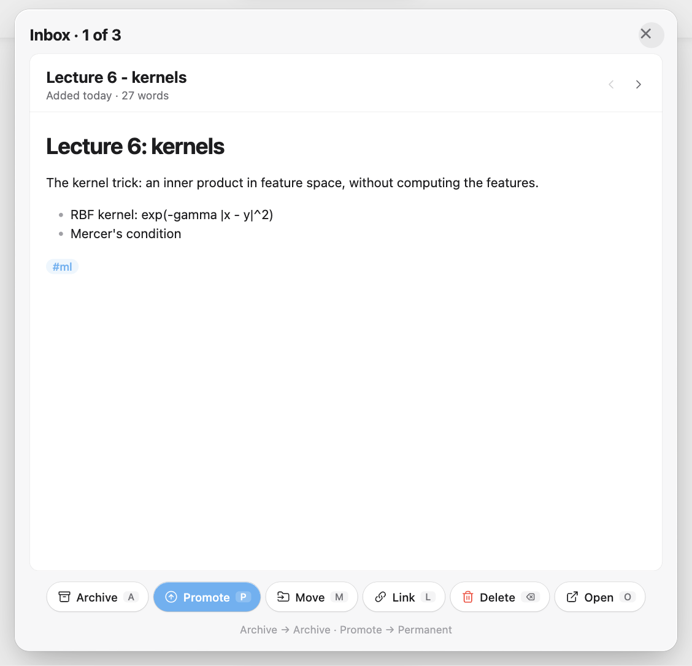

# Tahoe Organize

**Keep a growing vault tidy.** Go through your inbox one note at a time with single keys, keep saved searches in the sidebar, color notes by tag, link the notes you mention, find broken links and unused attachments, fix iCloud's duplicate copies, make literature notes from arXiv and DOI links, and search the text in your screenshots. Each tool can be switched off, and anything removed goes to the trash.



- **A** archives the note, **M** moves it (type a few letters of the folder), **P** promotes it to your permanent notes, and **U** undoes.
- Paste `https://arxiv.org/abs/1706.03762` and get a note with the title, authors, abstract, BibTeX and the PDF.
- `Note 2.md` from iCloud? See what differs from `Note.md`, then keep one, the other, or both.

Works on iPhone and iPad too (reading text in new images needs a Mac).

## The tools

- **Inbox triage** (the inbox icon in the ribbon, or *Triage inbox*): one note at a time. **A** archive, **P** promote to permanent notes, **M** move to a folder, **L** link to another note, **⌫** move to the trash, **O** open, **J**/**K** next and previous, **U** undo. The inbox, archive and permanent-notes folders are found from their names, or set in the settings. On iPhone the actions are big buttons.
- **Smart folders** (*Show smart folders*): saved searches in the sidebar that update as you write. *Today*, *This week* and *Open tasks* are there to start; add your own from rules for tag, folder, property, title, open tasks, and created or modified date, matching all or any of them.
- **Colored tags**: color dots in the file list for notes tagged `#red`, `#orange`, `#yellow`, `#green`, `#blue`, `#purple` or `#gray`, or with `color: red` in their properties. Tag pills in notes take the same color, and you can give your own tags a color (`#urgent` is red, `#done` green).
- **Link suggestions**: where a note mentions the title of another note, it gets a dotted underline. Click it to make it a link, or link them all with *Link all suggestions in this note*. Only the part of the note on screen is checked, so it stays fast in a big vault.
- **Vault health** (*Check vault health*): broken links (with a "did you mean" fix, *Create note* or *Unlink*), empty notes, unused attachments, very large files and notes nothing links to, each with a one-click fix.
- **iCloud conflicts** (*Find iCloud conflicts*): when two devices change the same file before iCloud syncs, iCloud keeps both and calls one "Note 2". This finds those copies and shows each one with its original. Identical copies go to the trash in one click; for copies that differ there's a line-by-line comparison and *Keep original*, *Keep copy* or *Keep both* (every line from each). It also finds duplicate settings folders (`.obsidian 2`) and lets you bring back plugins, themes and snippets that are only in the copy.
- **Literature notes** (*New literature note from link…*, or paste a bare arXiv or DOI link and click *Make a literature note*): a note named like *Vaswani 2017 - Attention Is All You Need*, with the title, authors, year, venue and links as properties, the abstract, headings for your notes and the key ideas, and the BibTeX. The PDF is saved next to it when it's free to download (from arXiv, or an open-access copy).
- **Text from images** (on a Mac): reads the words in screenshots, photos of slides and scanned pages, on your Mac. *Search text in images* finds them, and right-clicking an image gives *Copy text from image*. The text is kept in the plugin's folder, so it syncs and search works on iPhone too. Optionally, an index note lets Obsidian's own search find it as well.

Folders in *Settings → Files and links → Excluded files* are left out of link suggestions, vault health, smart folders, colored tags and image text.

<!-- tahoe-family -->
## The Tahoe family

Tahoe is a set of plugins and a theme that work on their own and fit together.

| | | |
| --- | --- | --- |
| **[Tahoe Run](https://github.com/krishnanefx/obsidian-tahoe-run)** | Run the code in your notes, like a notebook: Python with a debugger and variables view, MATLAB, and ~25 other languages. | available |
| **[Tahoe Math](https://github.com/krishnanefx/obsidian-tahoe-math)** | A calculator in your notes: type an expression ending in `=` and the answer appears. | available |
| **[Tahoe](https://github.com/krishnanefx/obsidian-tahoe-theme)** | A clean, Mac-like theme, in light and dark. | available |
| **[Tahoe Code](https://github.com/krishnanefx/obsidian-tahoe-code)** | An IDE in your code blocks: suggestions, checking as you type, quick fixes, go to definition, formatting and AI edits. | available |
| **[Tahoe Glass](https://github.com/krishnanefx/obsidian-tahoe-glass)** | Real refraction for the Tahoe theme's glass, and header cards on settings pages. | available |
| **Tahoe Organize** | Keep a growing vault tidy: inbox triage, smart folders, colored tags, link suggestions, vault health, literature notes and text from images. | this one |
| **[Tahoe Intelligence](https://github.com/krishnanefx/obsidian-tahoe-intelligence)** | On-device AI for your notes: ask your notes, related notes, distilling permanent notes and more. | available |

**Better together**

- **With [Tahoe Intelligence](https://github.com/krishnanefx/obsidian-tahoe-intelligence):** inbox triage suggests a folder, tags and a better title for each note (Tab takes them), smart folders can match what a note is about, and vault health finds notes that say the same thing.
- **With [Tahoe](https://github.com/krishnanefx/obsidian-tahoe-theme):** the tool pages take the theme's settings-style cards and grouped rows, and clear its floating toolbar.
<!-- /tahoe-family -->

## Disclosures

- **Network use:** only when you make a literature note. Its details come from export.arxiv.org and arxiv.org (for arXiv links), or api.crossref.org, doi.org and api.semanticscholar.org (for DOIs), and the PDF from arXiv or the open-access copy Semantic Scholar lists. Nothing else is sent anywhere.
- **It runs programs on your Mac** (desktop only, for text from images): if Xcode's command line tools are installed, it builds a small helper with them once (`xcrun swiftc`) and runs it to read images; otherwise it uses AppleScript (`osascript`). Both use macOS's own text recognition, on your Mac.
- **Files outside your vault:** the helper is kept in `~/Library/Caches/tahoe-organize`, and the AppleScript in your system's temp folder.
- **Clipboard:** when you paste into a note, it checks whether the pasted text is a paper link, to offer a literature note (the paste goes in as usual). It writes to the clipboard only when you choose *Copy text from image*.
- **Removing things:** nothing is deleted outright. Identical copies, empty notes and unused attachments go to your computer's trash (on a phone, the vault's `.trash` folder); a note you delete in triage goes to the vault's `.trash` folder, so Undo can bring it back.
- **No telemetry, ads, accounts or payments.**

## Credits

Tahoe Organize is an independent project. It isn't affiliated with, or endorsed by, Apple.

## License

[MIT](LICENSE) © 2026 Krishnan Adaikkappan

## Building from source

```sh
npm ci
npm run build     # writes main.js
```

Releases are built by GitHub Actions: push a tag that matches the version in `manifest.json`, then publish the draft release it creates.
